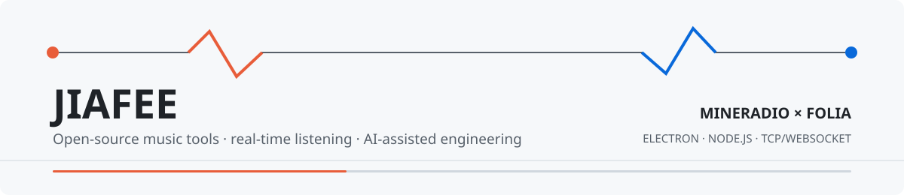
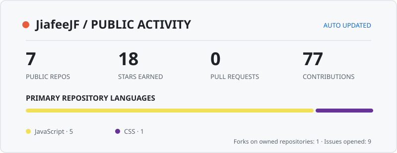

  <picture>
    <source media="(prefers-color-scheme: dark) and (max-width: 600px)" srcset="https://raw.githubusercontent.com/JiafeeJF/JiafeeJF/main/assets/header-mobile-dark.svg?v=2">
    <source media="(max-width: 600px)" srcset="https://raw.githubusercontent.com/JiafeeJF/JiafeeJF/main/assets/header-mobile-light.svg?v=2">
    <source media="(prefers-color-scheme: dark)" srcset="https://raw.githubusercontent.com/JiafeeJF/JiafeeJF/main/assets/header-dark.svg?v=2">
    <source media="(prefers-color-scheme: light)" srcset="https://raw.githubusercontent.com/JiafeeJF/JiafeeJF/main/assets/header-light.svg?v=2">
    
  </picture>

  独立开发者，熬大夜的夜猫子。 

  <a href="https://github.com/JiafeeJF/Mineradio-Jiafee-Patche"><strong>Mineradio 多功能补丁器</strong></a>
  &nbsp;·&nbsp;
  <a href="https://github.com/JiafeeJF/folia-jiafee-together-listen"><strong>Folia 一起听模组</strong></a>

## 正在构建

<table>
  <tr>
    <td width="50%" valign="top">
      <h3>Mineradio Jiafee Patch</h3>
      
面向 Mineradio 2.2.0 的多功能注入补丁器，提供音效增强、双人一起听、备份恢复与模块化安装。

      
<code>Electron</code> <code>Node.js</code> <code>TCP/WebSocket</code>

      <a href="https://github.com/JiafeeJF/Mineradio-Jiafee-Patche">查看项目 →</a>
    </td>
    <td width="50%" valign="top">
      <h3>Jiafee Together Listen for Folia</h3>
      
基于 Folium 公开 API 的一起听模组，适配双人播放、队列同步、账号资料与文字互动。

      
<code>Folium</code> <code>JavaScript</code> <code>Real-time sync</code>

      <a href="https://github.com/JiafeeJF/folia-jiafee-together-listen">查看项目 →</a>
    </td>
  </tr>
</table>

## 正在使用/学习的技术

  
  
  
  
  
  
  
  
  
  
  
  
  
  
  
  
  
  
  
  
  
  
  

## GitHub 数据

  <picture>
    <source media="(prefers-color-scheme: dark)" srcset="https://raw.githubusercontent.com/JiafeeJF/JiafeeJF/output/github-stats-dark.svg">
    
  </picture>

  <picture>
    <source media="(prefers-color-scheme: dark)" srcset="https://raw.githubusercontent.com/JiafeeJF/JiafeeJF/output/github-contribution-grid-snake-dark.svg">
    <source media="(prefers-color-scheme: light)" srcset="https://raw.githubusercontent.com/JiafeeJF/JiafeeJF/output/github-contribution-grid-snake.svg">
    
  </picture>

持续构建，真实测试，保持开源。

